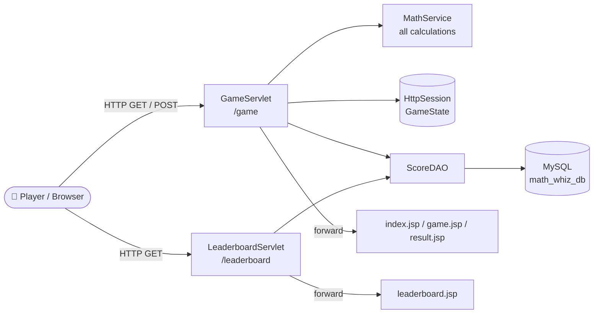
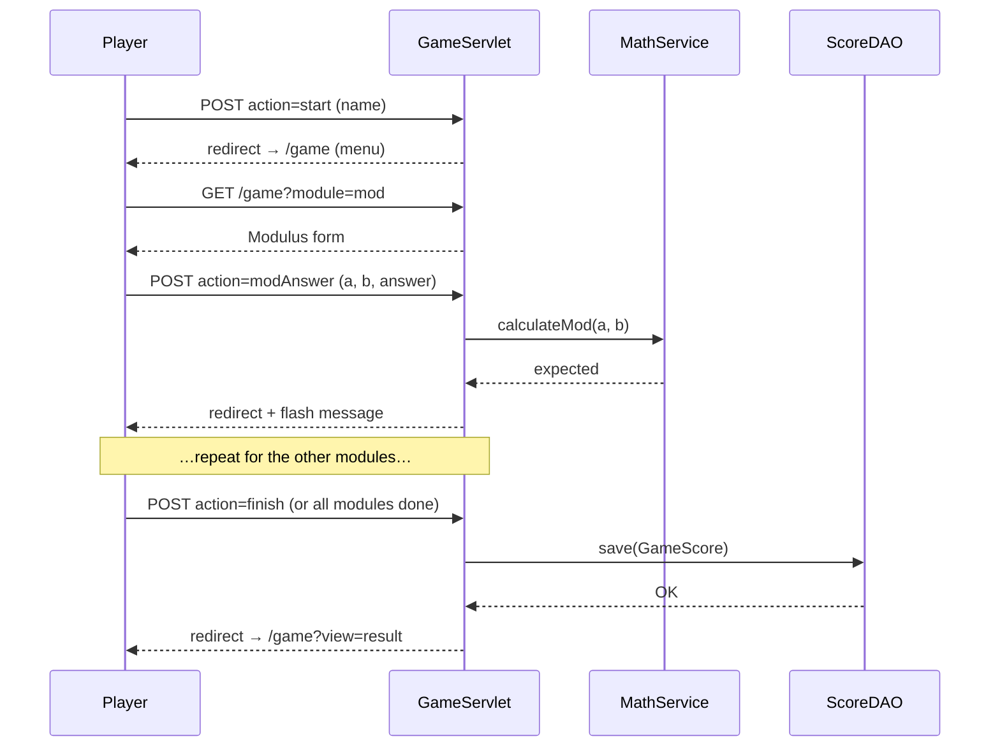

<div align="center">
🧮 RAIYYAN – MATH WHIZ
Create your own maths problem, solve it, and let Java check your answer.


🚀 Download ·
📸 Screenshots ·
⚙️ Installation ·
🧠 Code Walkthrough ·
🐞 Report a Bug
</div>
---
📑 Table of Contents
About the Project
Features
Screenshots
Game Rules & Marking
Tech Stack
Architecture
Project Structure
Database Design
Getting Started
Code Walkthrough
Validation & Edge Cases
Testing
Troubleshooting
Roadmap
Contributing
License
Author
---
📖 About the Project
RAIYYAN – Math Whiz is a Java web application built with Jakarta Servlets, JSP/JSTL and MySQL.
Unlike a normal quiz that shows fixed questions, here the player sets the question:
In the Prime module you type a number, the game adds a random value, and you decide if the result is prime.
In the Modulus module you choose two integers and work out the remainder yourself.
In the Trigonometry module you choose `sin`, `cos` or `tan`, an angle, and type the value you think it has.
Nothing is hard-coded. Every correct answer is calculated live by Java (`MathService`), compared with the player's answer, and marks are awarded. Final scores are saved to a MySQL database and shown on a Top 10 leaderboard.
> 💡 The project follows a clean **MVC-style** layout: Servlets (controller) → Model classes + Service (logic) → DAO (database) → JSP (view).
---
✨ Features
	Feature	Details
🎮	3 maths modules	Prime Number, Modulus, Trigonometry
🧠	Real calculation by Java	No stored answers; everything is computed at runtime
🏆	Top 10 leaderboard	Sorted by score (high → low), then by earliest time
💾	MySQL persistence	Name, score, difficulty and date/time saved via JDBC
🔁	Retry save	If the DB is down, the result page offers a Retry Save button
🛡️	Input validation	Empty names, non-numbers, zero divisor, undefined `tan`, out-of-range values
🔒	XSS-safe output	All user text rendered with `<c:out>`
🧭	Post-Redirect-Get	Refreshing the page never re-submits an answer
💬	Flash messages	One-time success/error banners stored in the session
🧪	Unit tests	JUnit 5 tests for all maths logic
📱	Responsive UI	Clean card layout that works on mobile
---
📸 Screenshots
> Put your screenshots in `docs/screenshots/` using the file names below and they will show up automatically.
Home Page	Module Menu
	

Prime – Step 1	Prime – Step 2
	

Modulus	Trigonometry
	

Final Result	Leaderboard
	
---
🎯 Game Rules & Marking
Module	What the player does	How Java checks it	Marks
Prime Number	Types a number `n`. Game adds a random `1–20`. Player answers `1` (prime) or `0` (not prime).	`MathService.isPrime(n + extra)`	3
Modulus	Enters integers `a`, `b` and their answer for `a % b`.	`MathService.calculateMod(a, b)`	3
Trigonometry	Chooses `sin`/`cos`/`tan`, enters degrees and the value.	`Math.sin/cos/tan(Math.toRadians(x))`, tolerance ±0.01	4
		Total	10
Each module can be played only once.
A wrong answer gives 0 marks and shows the correct answer.
The game ends automatically when all 3 modules are done, or the player can press Finish & Save Score at any time (after at least one module).
---
🛠 Tech Stack
Layer	Technology
Language	Java 17+
Web	Jakarta Servlet 6.0, JSP, JSTL (`jakarta.tags.core`)
Server	Apache Tomcat 10.1+ (required for the `jakarta.*` namespace)
Database	MySQL 8 + JDBC (`mysql-connector-j`)
Build	Maven
Testing	JUnit 5
Frontend	HTML5, CSS3 (custom properties, Grid/Flexbox) – no frameworks
---
🏗 Architecture

Request flow of one game

---
📂 Project Structure
```text
math-whiz/
├── pom.xml
├── README.md
├── database/
│   └── math_whiz_db.sql
├── docs/
│   └── screenshots/                 ← put your screenshots here
└── src/
    ├── main/
    │   ├── java/
    │   │   ├── controller/
    │   │   │   ├── GameServlet.java          # whole game flow
    │   │   │   └── LeaderboardServlet.java   # top 10 page
    │   │   ├── dao/
    │   │   │   └── ScoreDAO.java             # SQL for game_scores
    │   │   ├── model/
    │   │   │   ├── Attempt.java              # one answered question
    │   │   │   ├── GameScore.java            # one DB row
    │   │   │   ├── GameState.java            # game in progress (session)
    │   │   │   └── MathModule.java           # enum: modules + marks
    │   │   ├── service/
    │   │   │   └── MathService.java          # ALL maths logic
    │   │   └── util/
    │   │       └── DBConnection.java         # JDBC connection
    │   └── webapp/
    │       ├── index.jsp                     # welcome / start
    │       ├── game.jsp                      # menu + all module screens
    │       ├── result.jsp                    # final result
    │       ├── leaderboard.jsp               # top 10
    │       ├── css/style.css
    │       └── WEB-INF/web.xml
    └── test/
        └── java/service/MathServiceTest.java
```
> Your folder names may differ slightly. The package names (`controller`, `dao`, `model`, `service`, `util`) are what matter.
---
🗄 Database Design
Database: `math_whiz_db` · Table: `game_scores`
Column	Type	Notes
`id`	`INT AUTO_INCREMENT`	Primary key
`player_name`	`VARCHAR(100)`	Not null
`score`	`INT`	Not null (0–10)
`difficulty`	`VARCHAR(20)`	Default `'NORMAL'`
`played_at`	`TIMESTAMP`	Default `CURRENT_TIMESTAMP`
```sql
CREATE DATABASE IF NOT EXISTS math_whiz_db;
USE math_whiz_db;

CREATE TABLE IF NOT EXISTS game_scores (
    id          INT AUTO_INCREMENT PRIMARY KEY,
    player_name VARCHAR(100) NOT NULL,
    score       INT          NOT NULL,
    difficulty  VARCHAR(20)  NOT NULL DEFAULT 'NORMAL',
    played_at   TIMESTAMP    NOT NULL DEFAULT CURRENT_TIMESTAMP
);
```
Useful queries
```sql
-- See all saved records
SELECT * FROM game_scores;

-- Top 10 leaderboard (same query the app uses)
SELECT * FROM game_scores ORDER BY score DESC, played_at ASC LIMIT 10;

-- Delete all old scores and restart IDs from 1
TRUNCATE TABLE game_scores;
```
---
🚀 Getting Started
✅ Prerequisites
Tool	Version
JDK	17 or newer
Apache Tomcat	10.1+ (Tomcat 9 will not work – it uses `javax.*`, this project uses `jakarta.*`)
MySQL Server	8.0+
Maven	3.8+
IDE (optional)	IntelliJ IDEA / Eclipse / NetBeans
1️⃣ Get the code
```bash
git clone https://github.com/YOUR_USERNAME/YOUR_REPO.git
cd YOUR_REPO
```
Or ⬇️ download the ZIP and extract it.
2️⃣ Create the database
```bash
mysql -u root -p < database/math_whiz_db.sql
```
(or open `math_whiz_db.sql` in MySQL Workbench and run it).
3️⃣ Set your MySQL credentials
Open `src/main/java/util/DBConnection.java` and change:
```java
private static final String USER = "root";
private static final String PASSWORD = "1234";   // ← your own password
```
4️⃣ Build
```bash
mvn clean package
```
This creates a `.war` file inside `target/`.
5️⃣ Run on Tomcat
Option A – Deploy the WAR
Copy `target/<name>.war` into `TOMCAT_HOME/webapps/`.
Start Tomcat (`bin/startup.sh` or `bin/startup.bat`).
Open 👉 http://localhost:8080/<name>/
Option B – From the IDE (IntelliJ / Eclipse)
Add a Tomcat 10.1 run configuration.
Deploy the project as a war exploded artifact.
Run and open the URL shown (for example `http://localhost:8080/math-whiz/`).
🔗 Application URLs
URL	Purpose
`/` or `/index.jsp`	Welcome page, enter your name
`/game`	Module menu (needs a started game)
`/game?module=prime`	Prime module
`/game?module=mod`	Modulus module
`/game?module=trig`	Trigonometry module
`/game?view=result`	Final result page
`/leaderboard`	Top 10 scores
---
🧠 Code Walkthrough
1. `MathService` – the brain 🧮
Every answer is computed here. Nothing is stored or hard-coded.
<details>
<summary><b>📄 Click to view full source – <code>MathService.java</code></b></summary>
```java
package service;

import java.math.BigDecimal;

public final class MathService {

    /** Decimal answers are accepted if they are within this distance of the real value. */
    public static final double TOLERANCE = 0.01;

    private static final double EPSILON = 1e-9;

    private MathService() {}

    /** Returns 1 if the number is prime, otherwise 0. Numbers below 2 are not prime. */
    public static int isPrime(int number) {
        if (number < 2) {
            return 0;
        }
        if (number < 4) {
            return 1;               // 2 and 3
        }
        if (number % 2 == 0) {
            return 0;
        }
        for (long i = 3; i * i <= number; i += 2) {
            if (number % i == 0) {
                return 0;
            }
        }
        return 1;
    }

    /** Returns the remainder of a / b using %. The divisor must not be zero. */
    public static int calculateMod(int a, int b) {
        if (b == 0) {
            throw new IllegalArgumentException("Divisor must not be zero.");
        }
        return a % b;
    }

    public static double calculateSin(double degree) {
        return Math.sin(Math.toRadians(degree));
    }

    public static double calculateCos(double degree) {
        return Math.cos(Math.toRadians(degree));
    }

    /** tan is undefined at 90, 270, ... degrees (cos = 0). */
    public static double calculateTan(double degree) {
        if (isTanUndefined(degree)) {
            throw new ArithmeticException(
                    "tan(" + plain(degree) + "°) is undefined. Please choose a different angle.");
        }
        return Math.tan(Math.toRadians(degree));
    }

    public static boolean isTanUndefined(double degree) {
        double reduced = ((degree % 180) + 180) % 180;
        return Math.abs(reduced - 90) < EPSILON;
    }

    /** Calculates sin, cos or tan of an angle given in degrees. */
    public static double calculateTrig(String ratio, double degree) {
        switch (ratio == null ? "" : ratio.toLowerCase()) {
            case "sin":
                return calculateSin(degree);
            case "cos":
                return calculateCos(degree);
            case "tan":
                return calculateTan(degree);
            default:
                throw new IllegalArgumentException("Ratio must be sin, cos or tan.");
        }
    }

    /** Compares two decimal numbers using the tolerance. */
    public static boolean isClose(double expected, double actual) {
        return Math.abs(expected - actual) <= TOLERANCE + 1e-12;
    }

    /** 30.0 -> "30", 0.5 -> "0.5" (for showing numbers to the player). */
    public static String plain(double value) {
        return BigDecimal.valueOf(value).stripTrailingZeros().toPlainString();
    }
}
```
</details>
How each algorithm works
Method	Idea
`isPrime`	Numbers `< 2` are not prime; `2` and `3` are prime; even numbers are not; otherwise test odd divisors up to `√n`. A `long` counter prevents overflow for large `int` values.
`calculateMod`	Uses Java's `%`. The result keeps the sign of the dividend: `-17 % 5 = -2`, `17 % -5 = 2`.
`calculateSin/Cos/Tan`	Converts degrees → radians with `Math.toRadians`, then calls `Math.sin/cos/tan`.
`isTanUndefined`	Reduces the angle to `[0, 180)` and checks if it is `90°` (works for `270°`, `-90°`, …).
`isClose`	Accepts an answer within ±0.01 of the real value (so `cos 30° = 0.87` is accepted).
`plain`	Prints `30.0` as `30` and `0.5` as `0.5` for clean display.
---
2. `MathModule` – modules and marks 🎯
<details>
<summary><b>📄 View source – <code>MathModule.java</code></b></summary>
```java
package model;

public enum MathModule {
    PRIME("Prime Number", 3),
    MOD("Modulus", 3),
    TRIG("Trigonometry", 4);

    private final String label;
    private final int marks;

    MathModule(String label, int marks) {
        this.label = label;
        this.marks = marks;
    }

    public String getLabel() { return label; }

    public int getMarks() { return marks; }

    public static int totalMarks() {
        int total = 0;
        for (MathModule m : values()) {
            total += m.marks;
        }
        return total;
    }
}
```
</details>
An `enum` keeps module names and marks in one place. `totalMarks()` always returns `10`, and the UI reads marks from here instead of repeating numbers.
---
3. `Attempt` – one answered question 📝
<details>
<summary><b>📄 View source – <code>Attempt.java</code></b></summary>
```java
package model;

import java.io.Serializable;

public class Attempt implements Serializable {
    private static final long serialVersionUID = 1L;

    private final MathModule module;
    private final String question;
    private final String yourAnswer;
    private final String correctAnswer;
    private final boolean correct;
    private final int marks;

    public Attempt(MathModule module, String question, String yourAnswer,
                   String correctAnswer, boolean correct) {
        this.module = module;
        this.question = question;
        this.yourAnswer = yourAnswer;
        this.correctAnswer = correctAnswer;
        this.correct = correct;
        this.marks = correct ? module.getMarks() : 0;
    }

    public MathModule getModule() { return module; }
    public String getModuleLabel() { return module.getLabel(); }
    public String getQuestion() { return question; }
    public String getYourAnswer() { return yourAnswer; }
    public String getCorrectAnswer() { return correctAnswer; }
    public boolean isCorrect() { return correct; }
    public int getMarks() { return marks; }
    public int getMaxMarks() { return module.getMarks(); }
}
```
</details>
An immutable record of what was asked, what the player said, what Java calculated, and the marks earned. It is `Serializable` because it lives in the HTTP session.
---
4. `GameState` – the game in progress 🎮
<details>
<summary><b>📄 View source – <code>GameState.java</code></b></summary>
```java
package model;

import java.io.Serializable;
import java.util.ArrayList;
import java.util.List;

public class GameState implements Serializable {
    private static final long serialVersionUID = 1L;

    private final String playerName;
    private final List<Attempt> attempts = new ArrayList<>();
    private int score;

    // Prime question waiting for the player's answer
    private Integer primeBase;
    private Integer primeExtra;
    private Integer primeNumber;

    private boolean finished;
    private boolean saved;
    private String saveError;

    public GameState(String playerName) {
        this.playerName = playerName;
    }

    public void record(Attempt attempt) {
        attempts.add(attempt);
        score += attempt.getMarks();
    }

    private Attempt find(MathModule module) {
        for (Attempt a : attempts) {
            if (a.getModule() == module) {
                return a;
            }
        }
        return null;
    }

    public void startPrime(int base, int extra) {
        this.primeBase = base;
        this.primeExtra = extra;
        this.primeNumber = base + extra;
    }

    public void clearPrime() {
        primeBase = null;
        primeExtra = null;
        primeNumber = null;
    }

    public String getPlayerName() { return playerName; }
    public int getScore() { return score; }
    public int getMaxScore() { return MathModule.totalMarks(); }
    public List<Attempt> getAttempts() { return attempts; }
    public int getAttemptCount() { return attempts.size(); }

    public Integer getPrimeBase() { return primeBase; }
    public Integer getPrimeExtra() { return primeExtra; }
    public Integer getPrimeNumber() { return primeNumber; }

    public Attempt getPrimeAttempt() { return find(MathModule.PRIME); }
    public Attempt getModAttempt() { return find(MathModule.MOD); }
    public Attempt getTrigAttempt() { return find(MathModule.TRIG); }

    public boolean isPrimeDone() { return getPrimeAttempt() != null; }
    public boolean isModDone() { return getModAttempt() != null; }
    public boolean isTrigDone() { return getTrigAttempt() != null; }
    public boolean isAllDone() { return isPrimeDone() && isModDone() && isTrigDone(); }

    public boolean isFinished() { return finished; }
    public void setFinished(boolean finished) { this.finished = finished; }

    public boolean isSaved() { return saved; }
    public void setSaved(boolean saved) { this.saved = saved; }

    public String getSaveError() { return saveError; }
    public void setSaveError(String saveError) { this.saveError = saveError; }
}
```
</details>
Stored in the HTTP session under the key `state`. It tracks the player, the list of attempts, the running score, the pending Prime question, and whether the score has been saved. A module is "done" when an `Attempt` for it exists, so it cannot be replayed.
---
5. `GameServlet` – the controller 🕹
One servlet (`/game`) handles the entire game.
Routes
Method	Parameters	Action
`GET`	(none)	Show the module menu
`GET`	`module=prime|mod|trig`	Show that module's screen
`GET`	`view=result`	Show the final result
`POST`	`action=start`	Create `GameState` from the player's name
`POST`	`action=primeGenerate`	Add a random 1–20 to the player's number
`POST`	`action=primeAnswer`	Check the 1/0 answer
`POST`	`action=modAnswer`	Check the remainder
`POST`	`action=trigAnswer`	Check the trig value
`POST`	`action=finish`	Save score and show result
Key snippet – dispatching actions
```java
switch (action) {
    case "primeGenerate": primeGenerate(req, resp, state); break;
    case "primeAnswer":   primeAnswer(req, resp, state);   break;
    case "modAnswer":     modAnswer(req, resp, state);     break;
    case "trigAnswer":    trigAnswer(req, resp, state);    break;
    case "finish":        finishRequested(req, resp, state); break;
    default:              resp.sendRedirect(req.getContextPath() + "/game");
}
```
Key snippet – Prime generation (random extra value)
```java
int extra = ThreadLocalRandom.current().nextInt(1, 21);   // 1..20
state.startPrime(base, extra);
resp.sendRedirect(req.getContextPath() + "/game?module=prime");
```
Key snippet – Modulus check (Java calculates the truth)
```java
int expected = MathService.calculateMod(a, b);       // <-- calculated by Java
Attempt attempt = new Attempt(MathModule.MOD, a + " % " + b,
        String.valueOf(answer), String.valueOf(expected), answer == expected);
complete(req, resp, state, attempt);
```
Key snippet – Trigonometry check (with tolerance)
```java
double expected = MathService.calculateTrig(ratio, degree);   // <-- calculated by Java
Attempt attempt = new Attempt(MathModule.TRIG,
        ratio + "(" + MathService.plain(degree) + "°)",
        MathService.plain(answer),
        String.format(Locale.ROOT, "%.4f", expected),
        MathService.isClose(expected, answer));
```
Key snippet – completing a question and the flash message
```java
private void complete(HttpServletRequest req, HttpServletResponse resp,
                      GameState state, Attempt attempt) throws IOException {
    state.record(attempt);
    String message = attempt.isCorrect()
            ? "Correct! You earned " + attempt.getMarks() + " marks."
            : "Not correct. The right answer was " + attempt.getCorrectAnswer() + ". 0 marks.";
    flash(req, attempt.isCorrect(), message);

    if (state.isAllDone()) {
        finishGame(state);
        resp.sendRedirect(req.getContextPath() + "/game?view=result");
    } else {
        resp.sendRedirect(req.getContextPath() + "/game");
    }
}
```
Key snippet – saving the score safely (only once)
```java
private void finishGame(GameState state) {
    state.setFinished(true);
    if (state.isSaved()) {
        return;                       // never save twice
    }
    try {
        scoreDAO.save(new GameScore(state.getPlayerName(), state.getScore(),
                DIFFICULTY, LocalDateTime.now()));
        state.setSaved(true);
        state.setSaveError(null);
    } catch (SQLException e) {
        log("Could not save score", e);
        state.setSaveError(e.getMessage());   // result page shows "Retry Save"
    }
}
```
Design patterns used
Post → Redirect → Get (PRG): every POST ends with `sendRedirect`, so refreshing never re-submits.
Flash messages: messages are stored in the session, shown once, then removed.
Guard clauses: finished games and completed modules redirect instead of being replayed.
---
6. `LeaderboardServlet` – top 10 🏆
```java
@WebServlet("/leaderboard")
public class LeaderboardServlet extends HttpServlet {
    private final ScoreDAO scoreDAO = new ScoreDAO();

    @Override
    protected void doGet(HttpServletRequest request, HttpServletResponse response)
            throws ServletException, IOException {
        try {
            request.setAttribute("scores", scoreDAO.findTop10());
        } catch (SQLException e) {
            log("Could not load leaderboard", e);
            request.setAttribute("error", "Could not load the leaderboard: " + e.getMessage());
        }
        request.getRequestDispatcher("/leaderboard.jsp").forward(request, response);
    }
}
```
---
7. `ScoreDAO` – database access 💾
<details>
<summary><b>📄 View source – <code>ScoreDAO.java</code></b></summary>
```java
package dao;

import model.GameScore;
import util.DBConnection;

import java.sql.Connection;
import java.sql.PreparedStatement;
import java.sql.ResultSet;
import java.sql.SQLException;
import java.sql.Timestamp;
import java.util.ArrayList;
import java.util.List;

public class ScoreDAO {

    private static final String INSERT_SQL =
            "INSERT INTO game_scores (player_name, score, difficulty, played_at) VALUES (?, ?, ?, ?)";

    private static final String TOP10_SQL =
            "SELECT id, player_name, score, difficulty, played_at FROM game_scores "
                    + "ORDER BY score DESC, played_at ASC LIMIT 10";

    public void save(GameScore score) throws SQLException {
        try (Connection con = DBConnection.getConnection();
             PreparedStatement ps = con.prepareStatement(INSERT_SQL)) {
            ps.setString(1, score.getPlayerName());
            ps.setInt(2, score.getScore());
            ps.setString(3, score.getDifficulty());
            ps.setTimestamp(4, Timestamp.valueOf(score.getPlayedAt()));
            ps.executeUpdate();
        }
    }

    public List<GameScore> findTop10() throws SQLException {
        List<GameScore> list = new ArrayList<>();
        try (Connection con = DBConnection.getConnection();
             PreparedStatement ps = con.prepareStatement(TOP10_SQL);
             ResultSet rs = ps.executeQuery()) {
            while (rs.next()) {
                GameScore s = new GameScore();
                s.setId(rs.getInt("id"));
                s.setPlayerName(rs.getString("player_name"));
                s.setScore(rs.getInt("score"));
                s.setDifficulty(rs.getString("difficulty"));
                Timestamp ts = rs.getTimestamp("played_at");
                s.setPlayedAt(ts == null ? null : ts.toLocalDateTime());
                list.add(s);
            }
        }
        return list;
    }
}
```
</details>
Uses `PreparedStatement` → protected against SQL injection.
Uses try-with-resources → connections are always closed.
Leaderboard order: highest score first, ties broken by earliest `played_at`.
---
8. `DBConnection` and `GameScore`
<details>
<summary><b>📄 View source – <code>DBConnection.java</code></b></summary>
```java
package util;

import java.sql.Connection;
import java.sql.DriverManager;
import java.sql.SQLException;

public class DBConnection {

    // >>> Change USER and PASSWORD to your own MySQL credentials <<<
    private static final String URL =
            "jdbc:mysql://localhost:3306/math_whiz_db?useSSL=false&allowPublicKeyRetrieval=true&serverTimezone=UTC";
    private static final String USER = "root";
    private static final String PASSWORD = "1234";

    private DBConnection() {}

    public static Connection getConnection() throws SQLException {
        try {
            Class.forName("com.mysql.cj.jdbc.Driver");
        } catch (ClassNotFoundException e) {
            throw new SQLException("MySQL JDBC driver not found. Reload the Maven project.", e);
        }
        return DriverManager.getConnection(URL, USER, PASSWORD);
    }
}
```
</details>
<details>
<summary><b>📄 View source – <code>GameScore.java</code></b></summary>
```java
package model;

import java.time.LocalDateTime;
import java.time.format.DateTimeFormatter;
import java.util.Locale;

public class GameScore {
    private static final DateTimeFormatter DISPLAY =
            DateTimeFormatter.ofPattern("dd MMM yyyy, hh:mm a", Locale.ENGLISH);

    private int id;
    private String playerName;
    private int score;
    private String difficulty;
    private LocalDateTime playedAt;

    public GameScore() {}

    public GameScore(String playerName, int score, String difficulty, LocalDateTime playedAt) {
        this.playerName = playerName;
        this.score = score;
        this.difficulty = difficulty;
        this.playedAt = playedAt;
    }

    public int getId() { return id; }
    public void setId(int id) { this.id = id; }

    public String getPlayerName() { return playerName; }
    public void setPlayerName(String playerName) { this.playerName = playerName; }

    public int getScore() { return score; }
    public void setScore(int score) { this.score = score; }

    public String getDifficulty() { return difficulty; }
    public void setDifficulty(String difficulty) { this.difficulty = difficulty; }

    public LocalDateTime getPlayedAt() { return playedAt; }
    public void setPlayedAt(LocalDateTime playedAt) { this.playedAt = playedAt; }

    /** Date/time ready for display in a JSP. */
    public String getPlayedAtFormatted() {
        return playedAt == null ? "" : playedAt.format(DISPLAY);
    }
}
```
</details>
> ⚠️ **Security note:** the DB password is hard-coded for simplicity. For a real deployment, move credentials to environment variables or a config file that is **not** committed to Git.
---
9. Views (JSP + JSTL) 🖼
File	Role
`index.jsp`	Name form + "How it works" table
`game.jsp`	One page that shows menu / primeInput / primeAnswer / mod / trig based on the `screen` attribute
`result.jsp`	Final score, answer table (yours vs. Java's), save status, Retry Save
`leaderboard.jsp`	Top 10 table
`css/style.css`	Theme, cards, forms, tables, responsive rules
How `game.jsp` switches screens
```jsp
<c:choose>
    <c:when test="${screen eq 'primeInput'}">  ... </c:when>
    <c:when test="${screen eq 'primeAnswer'}"> ... </c:when>
    <c:when test="${screen eq 'mod'}">         ... </c:when>
    <c:when test="${screen eq 'trig'}">        ... </c:when>
    <c:otherwise>                              <%-- module menu --%> </c:otherwise>
</c:choose>
```
Safe output (prevents XSS)
```jsp
<strong><c:out value="${state.playerName}"/></strong>
```
CSS theme variables (in `style.css`)
```css
:root {
    --bg: #f4f6fb;     --card: #ffffff;   --ink: #1f2937;
    --brand: #4f46e5;  --brand-dark: #3730a3;  --violet: #7c3aed;
    --ok: #166534;     --ok-bg: #dcfce7;
    --bad: #991b1b;    --bad-bg: #fee2e2;
}
```
---
10. `web.xml`
```xml
<web-app xmlns="https://jakarta.ee/xml/ns/jakartaee" version="6.0">
    <display-name>RAIYYAN - Math Whiz</display-name>

    <session-config>
        <session-timeout>60</session-timeout>   <!-- minutes -->
    </session-config>

    <welcome-file-list>
        <welcome-file>index.jsp</welcome-file>
    </welcome-file-list>
</web-app>
```
---
🛡 Validation & Edge Cases
Situation	What the app does
Empty player name	Back to home with an error
Name longer than 100 characters	Rejected with an error
Prime number outside ±1,000,000 or not an integer	Error message, stays on the input screen
Prime result `< 2` (0, 1, negatives)	Correct answer is 0 (Not Prime)
Modulus: non-integer input	Error: "Enter whole numbers…"
Modulus: divisor `b = 0`	Validation error, no marks lost
Trig: ratio other than sin/cos/tan	Error: "Select sin, cos or tan."
Trig: `tan(90°)`, `tan(270°)`, `tan(-90°)`	"Undefined" message, asks for another angle
Trig: `NaN` / `Infinity`	Rejected by `parseDouble`
Replaying a finished module	Redirected with a message
Opening `/game` without a session	Redirected to `index.jsp`
Refreshing after submitting	Safe – Post-Redirect-Get
Database offline	Result page shows the error and a Retry Save button
Score already saved	`state.isSaved()` prevents duplicate rows
---
🧪 Testing
Unit tests live in `src/test/java/service/MathServiceTest.java` (JUnit 5).
```bash
mvn test
```
Area	What is tested
Prime	`7 → 1`, `8 → 0`, `1 → 0`, `0` and negatives `→ 0`, `2`, `3`, `9`, `97`, and `2147483647` (largest `int` prime)
Modulus	`17 % 5 = 2`, negatives (`-17 % 5 = -2`, `17 % -5 = 2`), `0 % 5 = 0`, zero divisor throws
Trigonometry	`sin 30° = 0.5`, `cos 60° = 0.5`, `tan 45° = 1`, `tan` undefined at `90°/270°/-90°`, dispatcher accepts `"SIN"` and rejects `"sec"`
Tolerance	`0.8660254 ≈ 0.87` ✔, `0.5 vs 0.6` ✘
Marks	Total marks equal `10`
Formatting	`30.0 → "30"`, `0.5 → "0.5"`, `0.0 → "0"`
---
🧰 Troubleshooting
Problem	Fix
`HTTP 404` or JSP/servlet classes not found	You are probably on Tomcat 9. Use Tomcat 10.1+ (Jakarta namespace).
`MySQL JDBC driver not found`	Reload the Maven project so `mysql-connector-j` is downloaded.
`Access denied for user 'root'`	Update `USER` / `PASSWORD` in `DBConnection.java`.
`Unknown database 'math_whiz_db'`	Run `math_whiz_db.sql` first.
Time looks wrong on the leaderboard	The URL uses `serverTimezone=UTC`; change it to your timezone if needed (e.g. `Asia/Dhaka`).
Score "could not be saved"	Start MySQL, then press Retry Save on the result page.
Styles not loading	Check that `css/style.css` is inside `webapp/` and the context path is correct.
---
🗺 Roadmap
[ ] Selectable difficulty levels (Easy / Normal / Hard)
[ ] More modules (GCD/LCM, factorial, powers, algebra)
[ ] Timer per question
[ ] User accounts and personal history
[ ] Move DB settings to environment variables / connection pool (HikariCP)
[ ] Dockerfile + `docker-compose` (Tomcat + MySQL)
[ ] REST API + JSON leaderboard
[ ] Dark mode
---
🤝 Contributing
Contributions are welcome!
Fork the repository
Create a branch: `git checkout -b feature/amazing-feature`
Commit: `git commit -m "Add amazing feature"`
Push: `git push origin feature/amazing-feature`
Open a Pull Request
Please run `mvn test` before submitting.
---
📄 License
Distributed under the MIT License. See `LICENSE` for details.
---
👤 Author
RAIYYAN
GitHub: @YOUR_USERNAME
Project link: https://github.com/YOUR_USERNAME/YOUR_REPO
<div align="center">
⭐ If you like this project, give it a star! ⭐
Made with ☕ and Java
⬆ Back to top
</div>
